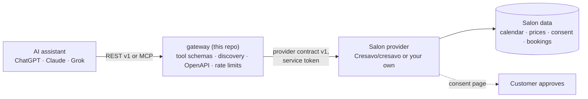

# Cresavo gateway

The agent-facing front door for [Cresavo](https://github.com/Cresavo/cresavo) salons. It lets AI assistants find a salon's services and free times and book them, through a REST v1 API and a Streamable HTTP MCP server, while every decision stays with the salon.

**Demo status:** This project is in the demo phase and is not production-ready. A public demo is not yet available; hosting and DNS still need to be configured. See the [known gaps before production](docs/SECURITY_MODEL.md#10-known-gaps-before-production).

All data in this repository is fictional. The demo salon "Salong Eko" does not exist.

## What this is

Cresavo is open-source booking software for small service businesses. This repository is its agent-facing front door: the part that lets a customer's AI assistant (ChatGPT, Claude, Grok or any MCP client) discover a salon, read its treatments and free times, and *propose* a booking. The assistant never books on its own: it proposes, the customer approves through the provider's own channel (for Cresavo, the salon's consent page), and the booking is created only within what was approved.

| | |
|---|---|
| **Interfaces** | REST v1 (OpenAPI 3.1) and Streamable HTTP MCP, plus discovery (`/.well-known/usp`, `/llms.txt`) |
| **Stores** | No customer database. Only rate-limit counters, keyed by client address, in memory or in an optional shared Redis store |
| **Runtime** | Node 24 (`engines` allows 22.12+), plain JavaScript with type checking, three runtime dependencies |
| **Status** | Demo phase, fictional data only, not production-ready |
| **License** | AGPL-3.0-only |

Related repository: [`Cresavo/cresavo`](https://github.com/Cresavo/cresavo), the salon workspace (studio, booking pages, booking engine) that this gateway sits in front of. Its [`docs/GATEWAY_SPLIT.md`](https://github.com/Cresavo/cresavo/blob/main/docs/GATEWAY_SPLIT.md) describes the contract between the two.

## Connect your booking system

The gateway works with any booking system that implements the [provider contract](docs/PROVIDER_CONTRACT.md). Cresavo is the first. [`docs/CONNECT_A_PROVIDER.md`](docs/CONNECT_A_PROVIDER.md) takes you from a local trial to a conformance check (`npm run provider:check`) and the full agent scenarios against your own system.

## How it fits Cresavo



The gateway has no customer database. Rate-limit counters (keyed by client address) live in memory unless you configure the shared store.

- Bookings are **propose and approve**: the assistant proposes, the customer approves on the salon's consent page, and the salon books only within what the customer approved (service, staff, time, duration, price).
- For each incoming request that reaches salon authentication, the gateway calls `GET /api/v1/access` once to confirm split mode and the caller's scopes. The result is shared only within that request.
- The gateway never invents a booking result. On a timeout, retry with the same `Idempotency-Key`.

Read [`docs/SECURITY_MODEL.md`](docs/SECURITY_MODEL.md) before changing anything that touches auth, limits or forwarding.

## Quickstart

Needs Node 24 and a Cresavo provider running in split mode (see `docs/GATEWAY_SPLIT.md` in the Cresavo repository).

```sh
npm ci
npm test            # unit tests
npm run test:e2e    # in-memory separate-channel fixture
npm run test:e2e:real # pinned split salon with local PostgreSQL and Chromium
```

Run against a local provider. Generate a 32-byte random token, give the same value to both processes, and keep it out of Git, URLs and logs:

```sh
export GATEWAY_SERVICE_TOKEN="$(node -e "console.log(require('node:crypto').randomBytes(32).toString('hex'))")"
export SALON_ORIGIN=http://127.0.0.1:3217
export PORT=3218
npm start
```

PowerShell:

```powershell
$env:GATEWAY_SERVICE_TOKEN = node -e "console.log(require('node:crypto').randomBytes(32).toString('hex'))"
$env:SALON_ORIGIN = 'http://127.0.0.1:3217'
$env:PORT = '3218'
npm start
```

Endpoints on `http://127.0.0.1:3218`:

| Path | What |
| --- | --- |
| `/` | Landing page for developers of AI assistants |
| `/.well-known/usp` | Discovery profile |
| `/llms.txt` | Short guide for assistants |
| `/api/v1/openapi` | OpenAPI 3.1 contract |
| `/api/v1/mcp` | Streamable HTTP MCP |
| `/api/v1/mcp/schema` | Native MCP input schemas (needs an agent credential) |
| `/healthz` | Liveness, no salon call |

Agent credentials go in the `Authorization` header, never in URLs.

## Configuration

| Variable | Default | Meaning |
| --- | --- | --- |
| `SALON_ORIGIN` | required | Salon provider origin. HTTPS, or HTTP on loopback only. |
| `GATEWAY_SERVICE_TOKEN` | required | 64 lowercase hex characters, shared with the salon. Secret. |
| `PORT` | `3218` | Listen port. |
| `GATEWAY_ALLOW_REMOTE` | `0` | `1` enables remote mode. |
| `GATEWAY_LISTEN_HOST` | `127.0.0.1` | `0.0.0.0` or `::` only in remote mode. |
| `GATEWAY_PUBLIC_ORIGIN` | unset | Public `https://` origin, required in remote mode. |
| `GATEWAY_LOOPBACK_TEST_LIMITS` | `0` | `1` raises the per-IP limits for local cross-repository proofs. Refused with remote mode, on Vercel and with a shared rate-limit store. |
| `GATEWAY_TRUST_PROXY_HOPS` | `0` | Proxies in front that append `X-Forwarded-For`, required (≥ 1) in remote mode. |
| `GATEWAY_RATE_LIMIT_REDIS_URL` | unset | Redis-protocol store that shares rate limits between instances. `rediss://` off loopback. Secret. |
| `GATEWAY_REQUIRE_SHARED_LIMITS` | unset | `1` refuses to start without the shared store. Automatic on Vercel. |

The default is loopback only. Remote mode refuses to start unless every remote flag is set correctly. See [`docs/HOSTING.md`](docs/HOSTING.md).

## Documentation

- [`docs/PROVIDER_CONTRACT.md`](docs/PROVIDER_CONTRACT.md): what a booking system implements to sit behind the gateway
- [`docs/CONNECT_A_PROVIDER.md`](docs/CONNECT_A_PROVIDER.md): connect your booking system step by step
- [`docs/SECURITY_MODEL.md`](docs/SECURITY_MODEL.md): threat model, tokens, limits, what the gateway never does
- [`docs/HOSTING.md`](docs/HOSTING.md): hosting options and the chosen setup
- [`docs/E2E.md`](docs/E2E.md): end-to-end test
- [`docs/PUBLICATION_AUDIT.md`](docs/PUBLICATION_AUDIT.md): history audit before publication
- [`CONTRIBUTING.md`](CONTRIBUTING.md), [`SECURITY.md`](SECURITY.md), [`CHANGELOG.md`](CHANGELOG.md)

## Compatibility

The gateway speaks [provider contract v1](docs/PROVIDER_CONTRACT.md); Cresavo is the first implementation. Discovery uses the USP profile format and MCP tool-name aliases only; full USP conformance is not claimed. No partner compatibility or assistant certification is implied.

## License

AGPL-3.0-only, see [`LICENSE`](LICENSE) and [`NOTICE`](NOTICE). If you run a modified version as a network service, you must offer its source to its users.

MCP input schemas, discovery and the v1 OpenAPI contract were adapted from the Cresavo salon repository (formerly `booking-lab-se`) at `6f5d143e096d42ff98e3714dee5ccc402a40e01b`. Runtime dependencies: the MCP SDK packages (Apache-2.0) and Zod (MIT); their license files ship in the npm packages.
